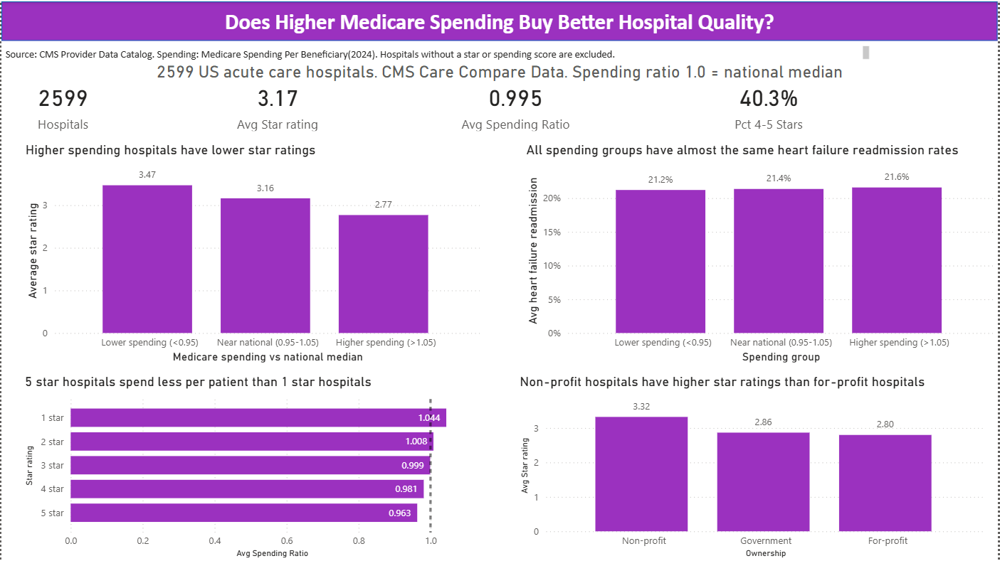
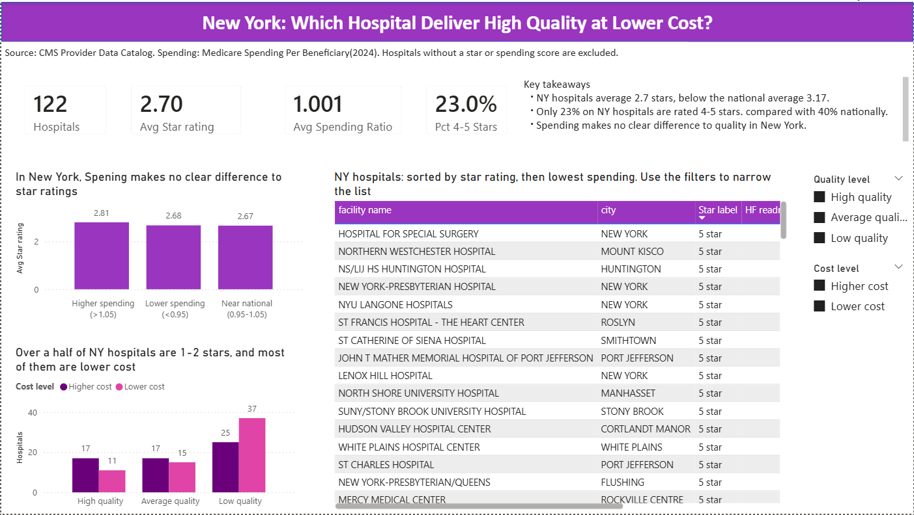

# Hospital Quality vs. Cost

This research asks a simple question: do hospitals that spend more per Medicare patient deliver better care? It compares Medicare spending with CMS quality ratings for about 2,600 US acute care hospitals, with a closer look at New York, and identifies the New York hospitals that combine high quality with lower cost.

The data was cleaned and joined in MySQL, and the results are presented in a two-page Power BI dashboard.



## Why this matters

Medicare and health plans are moving away from paying for the amount of care toward paying for its value, meaning quality relative to cost. If higher spending reliably produced better outcomes, the expensive hospitals would at least be getting something for the money. If it doesn't, there is room to cut costs without hurting patients, and the hospitals that already do both well are worth learning from.

## The data

Three public files from the [CMS Provider Data Catalog](https://data.cms.gov/provider-data):

- **Hospital General Information:** every US hospital, its type, ownership and CMS overall star rating (1 to 5)
- **Medicare Spending Per Beneficiary (2024):** Medicare spending per patient episode at each hospital divided by the national median, so 1.00 is typical and 1.10 is 10% more expensive. An episode runs from 3 days before admission to 30 days after discharge.
- **Unplanned Hospital Visits (July 2023 to June 2025):** 30-day readmission rates for heart failure, heart attack, pneumonia, COPD and hip or knee replacement

The analysis covers the 2,599 acute care hospitals that have both a star rating and a spending score, 122 of them in New York.

## Approach

**Profiling before loading.** The files had a few traps: hospital IDs with leading zeros and letters (stored as text), "Not Available" written inside number columns, names containing commas, and the same category spelled two ways.

**Cleaning** (`sql/02_explore_and_clean.sql`). Only acute care hospitals were kept. Star ratings are missing for 100% of psychiatric, children's and rural emergency hospitals and 71% of critical access hospitals, compared with 14% of acute care hospitals, so the other types would not give a fair comparison. "Not Available" was converted to NULL with `NULLIF` and then to numbers with `CAST`. The readmission file has one row per hospital per measure, so it was pivoted into one row per hospital with conditional aggregation before joining, to avoid duplicating hospitals in the join. The three tables were combined with LEFT JOINs so hospitals with partial data were not silently dropped.

**Analysis** (`sql/03_analysis.sql`). Hospitals were compared by spending group, star rating and ownership, and the strength of the relationship between spending and quality was measured with a Pearson correlation calculated in SQL. New York hospitals were placed in a quality and cost matrix.

**Dashboard.** The clean table was exported to Power BI. A missing-value problem came up during export: NULLs were written as zeros, which would have made unrated hospitals look like 0-star hospitals and pulled every average down. The export was redone through a view that writes missing values as empty cells.

## Findings

### Nationally, higher spending goes with lower ratings

| Spending group | Average star rating |
|---|---|
| Lower spending (ratio below 0.95) | 3.47 |
| Near national (0.95 to 1.05) | 3.16 |
| Higher spending (above 1.05) | 2.77 |

Seen from the other side, 5-star hospitals had an average spending ratio of 0.963 and 1-star hospitals 1.044. Outside New York the correlation between spending and star rating was weak and negative (r = -0.24). Spending explains only about 6% of the difference in ratings, but higher spending clearly does not buy higher quality.

Heart failure readmission rates were almost identical across spending groups (21.2%, 21.4% and 21.6%), so spending more did not reduce readmissions either.

Non-profit hospitals had higher average ratings (3.32) than government (2.86) and for-profit hospitals (2.80). For-profit hospitals also spent slightly more (1.026, against 0.988 for the other two groups).

### New York

New York hospitals scored well below the national average:

| | New York | United States |
|---|---|---|
| Average star rating | 2.70 | 3.17 |
| Rated 4 or 5 stars | 23% | 40% |
| Average spending ratio | 1.001 | 0.995 |

Within New York, spending made no clear difference to ratings (r = 0.04). Over half of NY hospitals (62 of 122) were rated 1 or 2 stars, and most of those (37) were lower cost, so low spending does not guarantee quality either.

| | Lower cost | Higher cost |
|---|---|---|
| High quality (4-5 stars) | **11** | 17 |
| Average quality (3 stars) | 15 | 17 |
| Low quality (1-2 stars) | 37 | 25 |

The 11 high-quality, lower-cost hospitals are listed in the dashboard's New York page.



## What this suggests

- Spending more is not a reliable path to better care. Payers and hospital leaders should look at what high-rated, lower-cost hospitals do differently rather than assume quality requires higher spending.
- The 11 New York hospitals with high quality and lower cost are natural models for the state's lower-rated hospitals.
- New York's gap with the national average, with only 23% of hospitals rated 4 or 5 stars, is large enough to deserve its own investigation.

## Limitations

- These are associations, not causes. One likely explanation for the negative link is that poor quality creates cost: complications and readmissions after discharge are counted in the spending measure.
- The star rating is a 1 to 5 scale, so it is a coarse summary of quality. Pearson correlation treats it as continuous; a rank-based check would be a useful addition.
- Results only apply to acute care hospitals with a rating. Hospitals without one are not a random group.
- The New York group is small (122 hospitals), and some subgroups, such as for-profit hospitals, are very small.
- The files cover different periods (spending for 2024, readmissions for mid-2023 to mid-2025).

## Files

```
sql/01_create_and_load.sql      load the three CMS files
sql/02_explore_and_clean.sql    profile, clean, pivot and join into hospital_analysis
sql/03_analysis.sql             analysis queries
data/processed/                 clean table used by Power BI
data/raw/                       not included; download from the CMS Provider Data Catalog
dashboard/                      Power BI file (.pbix)
images/                         dashboard screenshots
```

To open the dashboard, download the `.pbix` file and open it in Power BI Desktop (free, Windows). 
## Tools

MySQL, Power BI, Git and GitHub

Siloyiso Admire Tshababa | [Portfolio](https://admire5.github.io) | [LinkedIn](https://www.linkedin.com/in/admirethedataanalyst) | tsiloyiso@gmail.com
